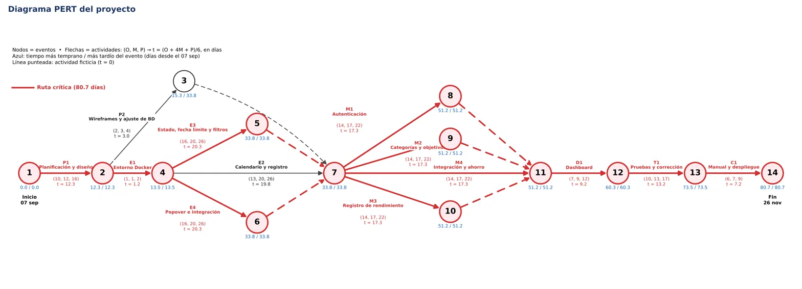
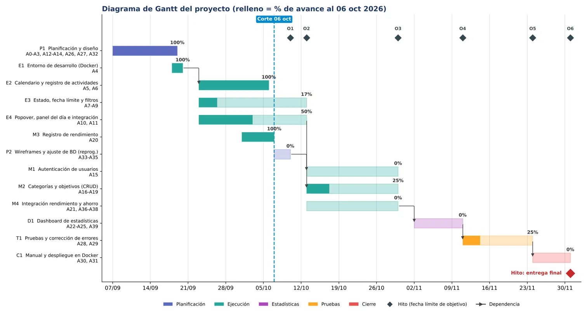

# Plan del proyecto

Línea base del 07 de septiembre al 30 de noviembre de 2026. Las fechas de la línea base no se modifican; los cambios se anotan como fecha estimada.

## Objetivos (SMART)

| ID | Objetivo | Actividades | Criterio de éxito | Fecha límite |
| --- | --- | --- | --- | --- |
| O1 | Completar la planificación y el diseño del sistema | A0–A3, A12–A14, A26, A27, A32–A35 | Requisitos, arquitectura, wireframes y modelo ER terminados | 09 oct 2026 (reprogramada) |
| O2 | Tener el calendario funcional con actividades, estado y filtros | A4–A11 | Actividades visibles en el calendario, marcadas como completadas o vencidas y filtrables | 12 oct 2026 |
| O3 | Implementar los módulos de gestión y el registro de rendimiento | A15–A21, A36–A38 | Alta, consulta y edición de cada módulo; rendimiento guardado por actividad | 29 oct 2026 |
| O4 | Construir el dashboard de estadísticas | A22–A25, A39 | Gráficas con cumplimiento, rachas y valor esperado contra obtenido | 10 nov 2026 |
| O5 | Validar el sistema con pruebas | A28, A29 | Pruebas unitarias y de integración ejecutadas y aprobadas | 23 nov 2026 |
| O6 | Documentar y desplegar el sistema en Docker | A30, A31 | Manual entregado y sistema levantado con Docker Compose | 30 nov 2026 |

## Actividades conocidas

| ID | Actividad | Línea base |
| --- | --- | --- |
| A4 | Entorno de desarrollo y repositorio (Docker) | 22 sep |
| A5 | Estructura base del calendario (mes y semana) | 23 sep – 12 oct |
| A6 | Registro de actividades (formulario y modelo) | 23 sep – 12 oct |
| A7 | Marcado de actividad completada/vencida | 23 sep – 12 oct |
| A8 | Restricción de fecha límite (30 nov) | 23 sep – 12 oct |
| A9 | Filtros del calendario por categoría y estado | 23 sep – 12 oct |
| A10 | Popover y panel de actividades del día | 23 sep – 12 oct |
| A11 | Integración calendario, actividades y objetivos | 23 sep – 12 oct |
| A15 | Autenticación de usuarios | 13–29 oct |
| A16 | Gestión de categorías (CRUD) | 13–29 oct |
| A17 | Gestión de objetivos (CRUD) | 13–29 oct |
| A18, A19 | Lista y detalle de objetivos; lista global de actividades | 13–29 oct |
| A20 | Registro de rendimiento | 13–29 oct |
| A21, A36–A38 | Integración con rendimiento; módulo de ahorro | 13–29 oct |
| A22–A25, A39 | Dashboard de estadísticas y gráficas | 02–10 nov |
| A28 | Pruebas unitarias e integración de módulos | 11–23 nov |
| A29 | Registro y corrección de errores | 11–23 nov |
| A30, A31 | Manual de usuario; despliegue en Docker y demo | 24–30 nov |
| A33–A35 | Wireframes de sesión y ahorro; ajuste de BD para ahorro | 19–21 sep (reprogramadas al 07–09 oct) |

A0–A3, A12–A14, A26, A27 y A32 forman la fase de planificación y diseño (P1); su detalle está en el primer avance.

## Fases y estimación PERT

Tiempo esperado t = (O + 4M + P) ÷ 6, en días.

| Fase | Actividades | O, M, P | t | Ruta crítica |
| --- | --- | --- | --- | --- |
| P1 Planificación y diseño | A0–A3, A12–A14, A26, A27, A32 | 10, 12, 16 | 12.3 | Sí |
| E1 Entorno de desarrollo (Docker) | A4 | 1, 1, 2 | 1.2 | Sí |
| P2 Wireframes y ajuste de BD | A33–A35 | 2, 3, 4 | 3.0 | No (holgura 18.5) |
| E2 Calendario y registro | A5, A6 | 13, 20, 26 | 19.8 | No (holgura 0.5) |
| E3 Estado, fecha límite y filtros | A7–A9 | 16, 20, 26 | 20.3 | Sí |
| E4 Popover, panel del día e integración | A10, A11 | 16, 20, 26 | 20.3 | Sí |
| M1 Autenticación | A15 | 14, 17, 22 | 17.3 | Sí |
| M2 Categorías y objetivos (CRUD) | A16–A19 | 14, 17, 22 | 17.3 | Sí |
| M3 Registro de rendimiento | A20 | 14, 17, 22 | 17.3 | Sí |
| M4 Integración rendimiento y ahorro | A21, A36–A38 | 14, 17, 22 | 17.3 | Sí |
| D1 Dashboard | A22–A25, A39 | 7, 9, 12 | 9.2 | Sí |
| T1 Pruebas y corrección | A28, A29 | 10, 13, 17 | 13.2 | Sí |
| C1 Manual y despliegue | A30, A31 | 6, 7, 9 | 7.2 | Sí |

Ruta crítica: P1 → E1 → E3/E4 → M1–M4 → D1 → T1 → C1 = **80.7 días** (07 sep → 26 nov), dentro de la fecha límite del 30 nov. M1–M4 corren en paralelo en la red; E3 y E4 también.

Dependencias clave: P2 antes de M1 (autenticación y ahorro dependen de los wireframes y del ajuste de BD); M3 es la base de D1, por eso se adelantó.

## Gantt (avance al 06 oct 2026)

| Fase | Avance al 06 oct |
| --- | --- |
| P1, E1, E2, M3 | 100 % |
| E4 | 50 % |
| M2, T1 | 25 % |
| E3 | 17 % |
| P2, M1, M4, D1, C1 | 0 % |

## Corte al 25 oct 2026 (Parcial 2)

Descartadas: A7, A9, A10, A11 (36 actividades vigentes). A33–A34 completas; A35 estimada 25–27 oct; A8 estimada 25–26 oct; ahorro (A36–A38) en mínimo funcional, estimado al 31 oct. Re-estimación por tres puntos de lo pendiente (días): A35 2.0 · A8 1.1 · A15 2.2 · A16–A17 2.0 · M4 4.2 · D1 8.0 · T1 13.2 · C1 7.2. Ruta crítica: corte (día 48) → P2 → M4 → D1 → T1 → C1 = 82.6 días (28 nov). Diagramas: `img/gantt_actualizado.png`, `img/pert_actualizado.png`. La línea base no cambia.
