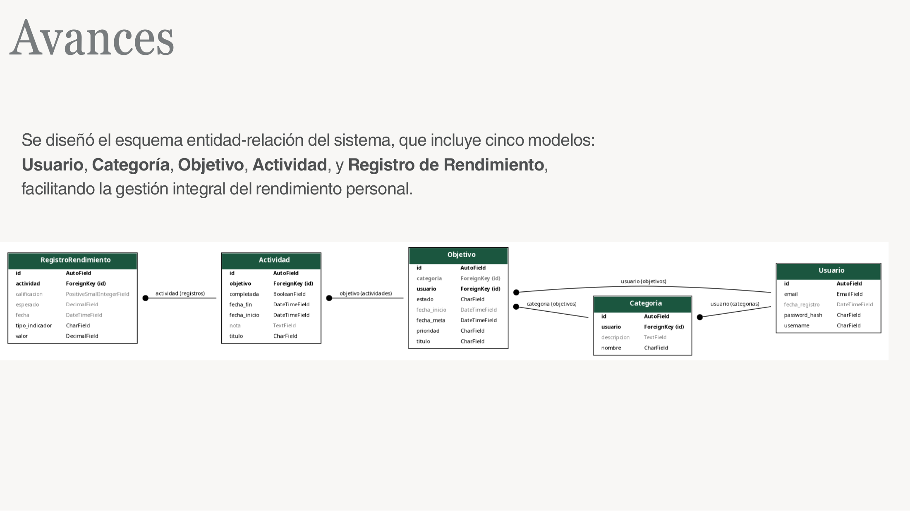

# Visión del proyecto

Fuente: presentación inicial (`entregas/Presentacion_Sistema_de_gestion_de_rendimiento.pdf`).

## Problema

Muchas personas se proponen metas personales (hacer ejercicio, ahorrar dinero, estudiar algo nuevo), pero les cuesta darles seguimiento real: terminan con listas de tareas sueltas que no reflejan si avanzan hacia algo concreto ni qué tan bien lo hacen.

## Solución

Un gestor personal de metas con vista de calendario. El usuario:

- planifica objetivos de mediano o largo plazo;
- los desglosa en actividades concretas del día a día;
- registra resultados medibles de cada actividad.

Con eso obtiene una visión honesta de su progreso: qué tan seguido cumple lo que se propone, qué objetivos están por vencer y en qué áreas de su vida es más constante.

**Alcance:** aplicación web de uso local/personal, para una sola persona que gestiona su propia información. No es multiusuario colaborativa por ahora.

## Tecnologías y justificación

| Tecnología | Por qué |
| --- | --- |
| Django (Python) | El ORM modela las relaciones usuario → objetivo → actividad → registro sin SQL a mano; el admin agiliza la gestión de datos en desarrollo; ecosistema maduro para CRUD, APIs (Django REST Framework) y plantillas. |
| PostgreSQL | Mejor integridad referencial y tipos de datos más robustos; el sistema depende de tablas relacionadas y de consultas agregadas para estadísticas; combinación más usada con Django. |
| Docker y Docker Compose | Levantan el entorno completo (app y base de datos) de forma reproducible con un solo comando. |
| FullCalendar (JavaScript) | Librería estándar para calendarios, con vistas nativas por día, semana y mes. |

## Elementos del sistema

| Entidad | Descripción |
| --- | --- |
| Usuario | Persona que usa la app. Todo (categorías, objetivos, actividades, registros) le pertenece. |
| Categoría | Área de vida (salud, estudio, trabajo, finanzas…). Filtra y clasifica; pertenece a un usuario. |
| Objetivo | Meta de mediano o largo plazo con fecha de inicio, fecha límite y prioridad. Estado: pendiente, en progreso, completado o vencido, actualizable automáticamente según el plazo. Puede existir sin actividades. |
| Actividad | Acción concreta con fecha y horario, siempre ligada a un objetivo. Se ve en el calendario y se marca como completada. |
| Registro de rendimiento | Medición cuantitativa de una actividad realizada: valor obtenido, valor esperado (para el % de cumplimiento) y calificación de satisfacción. |

En el código (desde el 11 nov) el objetivo pasa a `vencido` automáticamente cuando su fecha meta ya pasó y seguía pendiente o en progreso (`Objetivo.objects.marcar_vencidos()`).

## Impacto esperado

- **Organización personal:** seguimiento de metas y actividades para aumentar la productividad diaria.
- **Apoyo educativo:** herramientas de planeación que fomentan el hábito de estudio y ayudan a gestionar tareas y proyectos académicos.
- **Decisiones informadas:** indicadores para decidir con datos y gestionar mejor el tiempo y los recursos.
